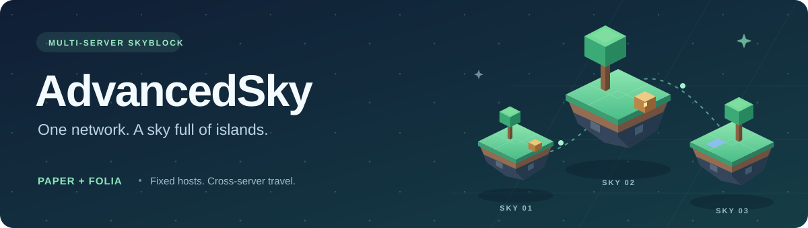
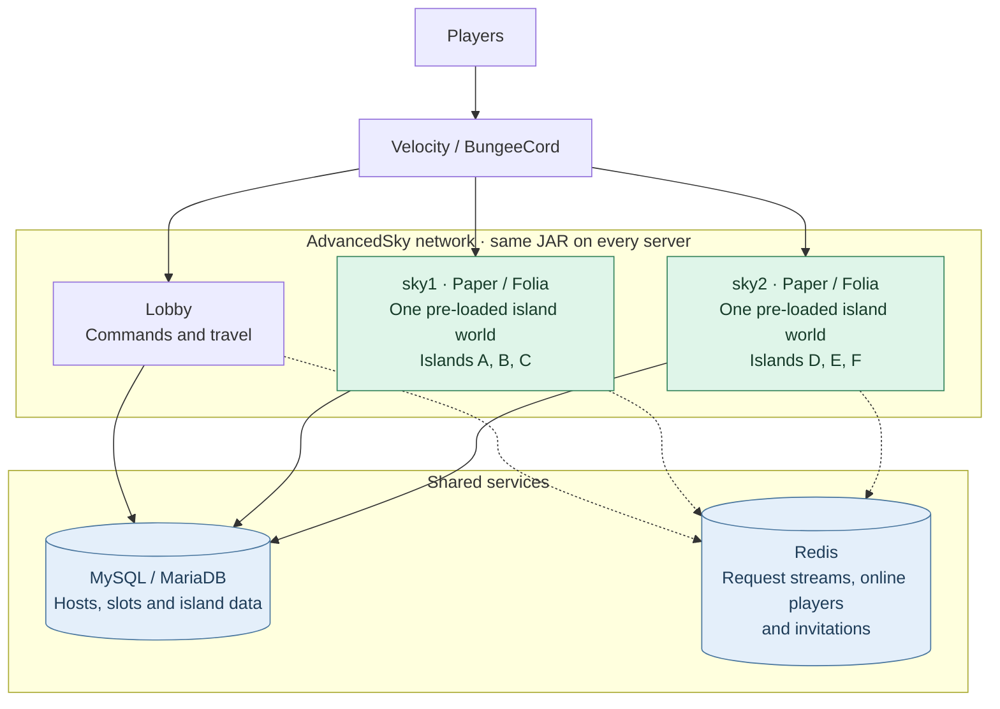
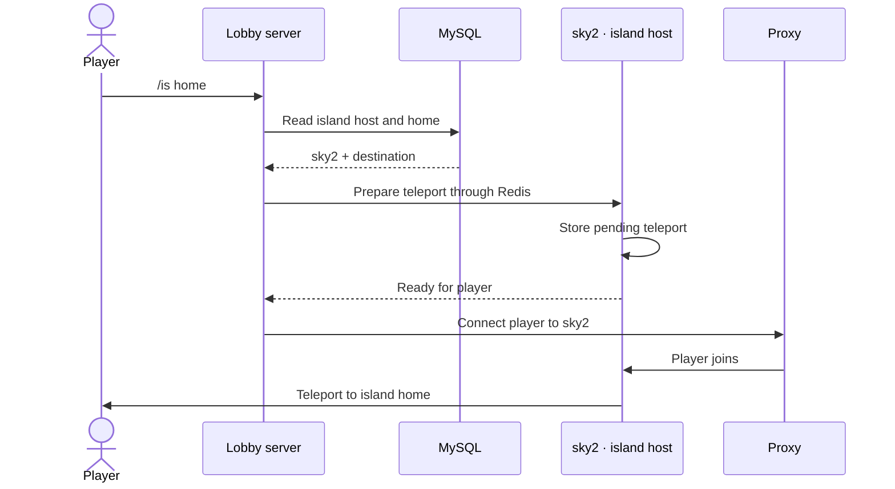
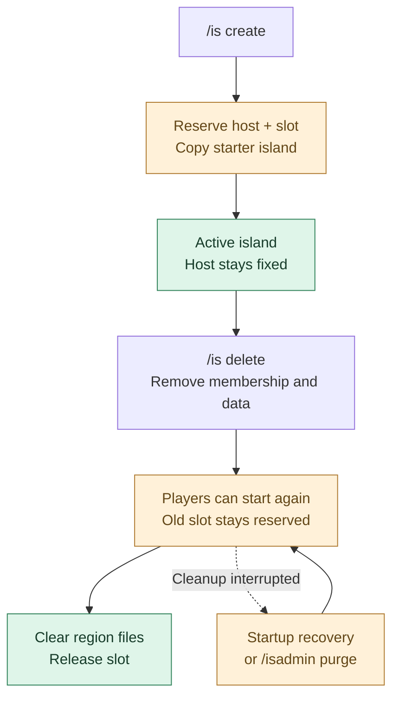

<p align="center">
  
</p>

<p align="center">
  <strong>A multi-server Skyblock engine for Paper and Folia.</strong><br>
  Distribute new islands across your network. Keep each island on its own host. Travel from anywhere.
</p>

<p align="center">
  
  
  
  
</p>

<p align="center">
  
  
  
  
</p>

<p align="center">
  <a href="#features">Features</a> ·
  <a href="#installation">Get started</a> ·
  <a href="#architecture">Architecture</a> ·
  <a href="#commands">Commands</a> ·
  <a href="#developer-api">Developer API</a> ·
  <a href="https://github.com/kit8379/AdvancedSky/issues">Report an issue</a>
</p>

> [!WARNING]
> **AdvancedSky is in alpha.** Run it on a test network first and keep backups of your MySQL database.
> Run the same build on every server in the network. Configuration, schemas and messages use
> the current contract only; there are no upgrade migrations or compatibility paths.

## What AdvancedSky is

AdvancedSky spreads Skyblock islands across a **network of Minecraft servers**. New islands go to
the online island server with the fewest islands. Players can use `/is home` from anywhere
in the network to return to their island through the proxy.

Each island keeps the same host for its entire lifetime. Every island server uses **one
pre-loaded world**, with islands arranged on a fixed grid. AdvancedSky never loads or unloads
worlds at runtime, and the same JAR runs on both Paper and Folia.

| For players | For server owners | For developers |
| --- | --- | --- |
| Teams, homes, warps and cross-server travel | Islands distributed across multiple hosts | Public asynchronous API |
| Upgrades, levels and a leaderboard | Region-aware scheduling for Paper and Folia | PlaceholderAPI integration |
| Island protection, co-op and access controls | One island world per host, built-in `.schem` templates | Configurable commands and MiniMessage messages |

## Contents

- [Features](#features)
- [Requirements](#requirements)
- [Installation](#installation)
- [Configuration](#configuration)
- [Architecture](#architecture)
- [Cross-server travel](#cross-server-travel)
- [Island lifecycle](#island-lifecycle)
- [Commands](#commands)
- [Permissions](#permissions)
- [Upgrades, limits and levels](#upgrades-limits-and-levels)
- [PlaceholderAPI](#placeholderapi)
- [Developer API](#developer-api)
- [Building from source](#building-from-source)
- [Troubleshooting](#troubleshooting)

## Features

| | Feature | What you get |
| --- | --- | --- |
| 🌐 | **Multi-server islands** | Creation on the host with the fewest islands; homes, warps and lobby travel across the network |
| ⚡ | **Paper and Folia support** | Region scheduling for blocks and scans, player scheduling for teleports, asynchronous MySQL and Redis work |
| 👥 | **Teams and co-op** | Invitations, membership, ownership transfer and temporary co-op access |
| 🏠 | **Homes and warps** | Named homes per member and shared island warps |
| 🛡️ | **Protection and access** | Build, interaction, explosion, vehicle, hanging, teleport and PvP protection; locks, bans and visitor expulsion |
| 📈 | **Levels and rankings** | Configurable block values, automatic level scans, `/is top` and leaderboard placeholders |
| ⬆️ | **Vault upgrades** | Island size, team/co-op/home/warp limits, biome unlocks and generator rates |
| 🧱 | **Island limits** | Configurable block and entity caps inside each island's boundary |
| 🌱 | **Generators and biomes** | Cobblestone generator rates by upgrade level and biome changes per chunk |
| 🧩 | **Integrations and customization** | PlaceholderAPI, a public async API, command aliases, permissions and MiniMessage messages |

## Requirements

| Component | Requirement |
| --- | --- |
| Minecraft server | **Paper or Folia 1.21.11** |
| Java | **21** |
| Database | MySQL **8.0+** or MariaDB **10.2.4+**, shared by the network |
| Redis | **5.0+**, with Streams support |
| Proxy | Velocity or BungeeCord, with the BungeeCord plugin message channel enabled |
| Economy | Vault and an economy plugin with balances shared across every server |
| Worlds | One island world loaded **before AdvancedSky enables** on each island server |
| Starter island | A bundled default, or your own Sponge `.schem` v3 file; no template world or WorldEdit plugin required |
| Optional integration | PlaceholderAPI |

The plugin loader downloads the MySQL driver, HikariCP, Jedis and Adventure NBT on first start.

## Installation

1. **Prepare the network.** Set up the proxy, shared MySQL/MariaDB and Redis services. Install
   Vault and your shared economy plugin on each server running AdvancedSky.
2. **Build the plugin.** Follow [Building from source](#building-from-source), then place
   `AdvancedSky.jar` in the `plugins/` folder of each island and lobby server.
3. **Prepare the island world and schematic.** On each island server, arrange for a world named
   after `server.name` (for example `sky1` or `sky2`, using `level-name` in `server.properties`)
   to be loaded at startup, before AdvancedSky enables. The bundled starter island is saved
   automatically to `plugins/AdvancedSky/schematics/starter.schem` if it is missing. Replace
   it with your own Sponge `.schem` to customize it. Lobby servers only need their configured
   lobby world, with no schematic.
4. **Generate and edit the configuration.** Start once to generate `plugins/AdvancedSky/`,
   then stop the server. Set database credentials, Redis, server identity and role, the schematic
   path and a safe lobby spawn in `config.yml`.
5. **Share the settings.** Use the same configuration across the network, changing only
   `server.name` to match each server's name in the proxy and `lobby-only` for its role. Keep the schematic file the same
   on all island servers and grant the [player permissions](#permissions).
6. **Restart and try it.** Join a configured server, run `/is create`, then test `/is home`
   from a lobby server. The proxy should send you to your island's host.

For **Velocity**, enable the channel in `velocity.toml`:

```toml
bungee-plugin-message-channel = true
```

> [!IMPORTANT]
> AdvancedSky expects the island world to exist and already be loaded. It does not create or
> load it for you. On Folia, prepare it for startup rather than loading it at runtime. The starter
> island comes from a file; no second world is needed. The default file is supplied automatically.
> A missing custom schematic or an invalid schematic prevents
> an island server from enabling, with the file path and reason in the log.

## Configuration

The generated files live in `plugins/AdvancedSky/`. The defaults below link directly to the
files bundled with the plugin.

| File | Purpose |
| --- | --- |
| [config.yml](src/main/resources/config.yml) | Server identity and role, database, Redis, cluster, schematic and spawn locations |
| [commands.yml](src/main/resources/commands.yml) | Command aliases, permissions, syntax and descriptions |
| [messages.yml](src/main/resources/messages.yml) | MiniMessage text for commands and events |
| [upgrades.yml](src/main/resources/upgrades.yml) | Upgrade levels, prices, limits, biomes and generator rates |
| [limits.yml](src/main/resources/limits.yml) | Per-island block and entity limits |
| [levels.yml](src/main/resources/levels.yml) | Block values used to calculate island levels |

### Network layout

This excerpt shows the server and world settings for a network with two island servers and a
lobby. Merge it into the generated `config.yml`; configure the database and Redis there too.

```yaml
server:
  name: "sky1"              # This server's name in the proxy

lobby-only: false           # true on lobby servers; false on island servers

cluster-id: "default"       # Same on every server in this network

island:
  height: 100
  template:
    schematic: "schematics/starter.schem" # Relative to plugins/AdvancedSky/
  spawn: { x: 0.5, y: 1.0, z: 0.5, yaw: 0.0, pitch: 0.0 }

lobby:
  world-name: "world"
  location: { x: 0.0, y: 100.0, z: 0.0, yaw: 0.0, pitch: 0.0 }
```

- **Server roles:** use `lobby-only: false` on island servers and `true` on lobby servers.
  Each server name must be unique and match the proxy. Island worlds use that same name:
  `sky1` hosts its islands in `sky1`, and `sky2` in `sky2`.
- **Shared services:** use the same database, table prefix, Redis settings and `cluster-id`
  everywhere. Give independent networks sharing Redis different cluster IDs.
- **Availability:** ready servers register automatically in Redis. Heartbeats run every five
  seconds; stopping removes a server immediately, and a crash expires its registration within
  thirty seconds. No shared server lists are needed when adding a host. Existing islands keep
  their hosts; they are not moved when that host goes offline.
- **Clock synchronization:** run NTP on every server. Incoming requests older than ten seconds
  are refused, using the sender's timestamp.
- **Lobby destination:** `/is lobby`, deletion, locks, bans and expulsion send players to a
  randomly selected online lobby server at `lobby.location`.

### Template and island geometry

`island.template.schematic` names a Sponge `.schem` v3 file relative to
`plugins/AdvancedSky/`. The file is read once at startup. Its saved copy origin lands on the
new island's centre, using its required saved offset. `island.spawn` sets the new island's
`default` home **relative to that centre**.

The JAR includes a default starter island. When the default path is configured and the file
is missing, it is extracted automatically. Existing schematic files are never overwritten;
changing to a custom path requires supplying that file yourself.

Air is skipped. Block properties and block entity data, including chest contents and sign text,
are retained; entities and biomes are not copied. The selection and origin must fit inside the
island's 512 × 512 area and the world's build height at `island.height`. Selections are limited
to 4,194,304 blocks. Schematics from a newer Minecraft data version are rejected; export for
the server's Minecraft version.

To export with WorldEdit on a build server, select the starter island, stand at the desired
copy origin, run `//copy` and `//schem save sponge starter`, then copy `starter.schem` to every
island server's configured path. WorldEdit is only needed for exporting, not for running
AdvancedSky.

| Geometry | Value |
| --- | --- |
| Space between neighbouring island centres | **2,048 blocks** |
| Area reserved for each island | **512 × 512 blocks**, exactly one region file |
| Centre offset from the grid | **256 blocks** on both horizontal axes |
| Maximum configured `island-size` | **512 blocks** |
| Grid limit | Ring **8,191**, about **268 million** slots within 16.7 million blocks of the origin |

The grid follows a square spiral. Slots are unique across the network, and MySQL stores the
slot number rather than coordinates. The spacing helps keep neighbouring islands in separate
Folia regions; unusually large loaded areas can still cause regions to merge.

> [!IMPORTANT]
> Keep `island.height` and the grid constants unchanged once islands exist: island positions
> are derived from them. Template and spawn edits affect newly created islands; apply changes
> to the schematic file with a restart.

### Reloading

`/isadmin reload` reloads configuration files except `commands.yml`. Server identity and role,
the derived island world, database/Redis connections, `cluster-id` and the schematic path/contents
are read at startup and need a restart. Keep structural settings consistent across the network.
Files are generated for a fresh installation and then read without rewriting them. Missing required
settings, invalid types and unknown fields fail validation rather than being filled or converted.

## Architecture

The proxy moves players, Redis carries requests, and MySQL records persistent island data.
Each island host keeps a cache of its own islands for protection and access checks.



| Piece | Responsibility |
| --- | --- |
| **Island host** | Performs island changes locally, writes MySQL, updates the world and refreshes its cache |
| **MySQL/MariaDB** | Stores host and slot assignments, players, homes, warps, bans, co-ops, levels and upgrades |
| **Redis** | Provides per-server request streams, the online player registry and pending invitations |
| **Proxy** | Connects a player to the destination server through BungeeCord plugin messages |
| **Island cache** | Loads all of a host's islands before players join and refreshes after changes |
| **Schedulers** | Run block work and scans on region threads, player work on entity threads, and I/O asynchronously |

Island management follows **commands → API → feature handlers → database/world**. Changes to
the same island run in order. Creation, travel, invitation acceptance and automatic co-op quit
cleanup use cross-server requests; ordinary management runs on the island's host.

## Cross-server travel

A player on the lobby runs `/is home` while their island lives on `sky2`:



The same routing handles `/is warp` and `/is lobby`. If the player is already on the
destination server, the teleport runs there directly. Island worlds stay on their hosts
throughout the journey.

## Island lifecycle



**Creation:** choose the online island host with the fewest islands in MySQL, breaking
ties by server name order. Reserve the first free slot, create the owner's `default` home, clear
the old area and paste the cached schematic on the owning region threads. Activate the island, cache
it and send the player home. Concurrent creates can select the same host before new rows appear.

**Deletion:** `/is delete` requires three confirmations. The host removes island membership
and gameplay data in one transaction, blocks entry and moves players to the lobby. The command
finishes after this logical deletion, so former members can create or join another island
while physical cleanup continues. The old slot stays reserved until cleanup succeeds.

<details>
<summary><strong>Deletion recovery and storage details</strong></summary>

An island row carries `deleting = true` while creation is unfinished or deletion is pending.
On deletion, only that row and its slot remain: players, homes, warps, bans, co-ops, levels and
upgrades are removed. Deleting islands reject entry, edits and island teleports, including
those by operators.

The host saves and evicts the area's chunks on their region threads, waits for unloaded
holders, drains pending writes and closes region-file caches. It then deletes the area's
region, entity and POI files asynchronously before removing the reserved database row.
Cleanup stays in the old island's serial chain. There is no 24-hour sweep or local purge queue.

The storage barrier targets **Paper/Folia 1.21.11**. Unsupported internals, held chunks and
file/database failures keep the row and slot reserved for retry. Startup recovers unfinished
deletions; `/isadmin purge` retries them on the current island server. Failed or interrupted
creation uses the same recovery path, clearing the area before removing its row.

Ordinary cross-server requests time out after **30 seconds**; creation allows **three
minutes**. Deletion runs on the host and returns after logical deletion, before storage cleanup.

The `deleting` column is added automatically to existing tables. Obsolete `island_slots`
tables and queue files from earlier builds are unused and are not automatically dropped.

</details>

## Commands

| Audience | Base command | Alias |
| --- | --- | --- |
| Players | `/island` | `/is` |
| Administrators | `/islandadmin` | `/isadmin` |

By default, bare `/is` teleports home. `command.base-command-mode: "help"` changes it to show
help. Players without an island must run `/is create` explicitly.

### Everyday commands

| Command | Action |
| --- | --- |
| `/is create` | Create your island and go home |
| `/is home [name]` | Return to a home from any server; alias `/is go` |
| `/is invite <player>` | Invite a teammate while on your island |
| `/is accept` | Accept a pending invitation |
| `/is sethome [name]` | Set a named home on your island |
| `/is setwarp [name]` | Set a shared island warp |
| `/is warp <player> [name]` | Visit another island's warp |
| `/is upgrade <id> [buy]` | View or buy an upgrade on your island |
| `/is top` | View the island leaderboard |
| `/is lobby` | Return to a lobby server |

> [!NOTE]
> To manage an island, its owner or a team member must stand on their own active island.
> This applies to aliases and operators using player commands too. Co-ops and visitors cannot
> manage it. Creation, invitation acceptance/rejection, travel and read-only commands work elsewhere.

<details>
<summary><strong>All player commands and permissions</strong></summary>

Permission prefix: `advancedsky.island.player.`. Append the suffix in the second column.

| Command | Permission suffix | Action |
| --- | --- | --- |
| `/is create` | `create` | Create an island |
| `/is delete` | `delete` | Delete your island after three confirmations |
| `/is setowner <player>` | `setowner` | Transfer ownership to a member |
| `/is leave` | `leave` | Leave your island team |
| `/is invite <player>` | `invite` | Invite a player |
| `/is accept` | `accept` | Accept an invitation |
| `/is reject` | `reject` | Reject an invitation |
| `/is removemember <player>` | `removemember` | Remove a member |
| `/is expel <player>` | `expel` | Send a visitor to the lobby |
| `/is coop <player>` | `coop` | Grant co-op access |
| `/is uncoop <player>` | `uncoop` | Revoke co-op access |
| `/is cooplist` | `cooplist` | List co-op players |
| `/is ban <player>` | `ban` | Ban a player |
| `/is unban <player>` | `unban` | Unban a player |
| `/is banlist` | `banlist` | List banned players |
| `/is lock` | `lock` | Toggle island access |
| `/is pvp` | `pvp` | Toggle PvP |
| `/is sethome [name]` | `sethome` | Set one of your homes |
| `/is delhome <name>` | `delhome` | Delete one of your homes |
| `/is home [name]` | `home` | Teleport home; alias `go` |
| `/is setwarp [name]` | `setwarp` | Set an island warp |
| `/is delwarp <name>` | `delwarp` | Delete an island warp |
| `/is warp <player> [name]` | `warp` | Teleport to another island's warp |
| `/is info [player]` | `info` | Show island information |
| `/is level` | `level` | Show your island level |
| `/is top` | `top` | Show the leaderboard |
| `/is value` | `value` | Show the point value of the block in your hand |
| `/is upgrade <id> [buy]` | `upgrade` | View or buy an upgrade |
| `/is biome <biome>` | `biome` | Change the biome of the chunk you stand in |
| `/is lobby` | `lobby` | Return to the lobby |
| `/is help [page]` | `help` | Show command help |

Management commands are `delete`, `invite`, `removemember`, `setowner`, `leave`, `lock`, `pvp`,
`expel`, `ban`, `unban`, `coop`, `uncoop`, `sethome`, `delhome`, `setwarp`, `delwarp`, `biome`
and `upgrade`. Location-based edits must also be inside the island's 512 × 512 area in
the world named after its host's `server.name`.

</details>

<details>
<summary><strong>All admin commands and permissions</strong></summary>

Permission prefix: `advancedsky.island.admin.`. Append the suffix in the second column.

| Command | Permission suffix | Action |
| --- | --- | --- |
| `/isadmin create <player>` | `create` | Create an island for a player |
| `/isadmin delete <player>` | `delete` | Delete a player's island |
| `/isadmin addmember <member> <owner>` | `addmember` | Force-add a member |
| `/isadmin removemember <member> <owner>` | `removemember` | Force-remove a member |
| `/isadmin coop <owner> <player>` | `coop` | Add a co-op player |
| `/isadmin uncoop <owner> <player>` | `uncoop` | Remove a co-op player |
| `/isadmin ban <owner> <player>` | `ban` | Ban a player from an island |
| `/isadmin unban <owner> <player>` | `unban` | Unban a player |
| `/isadmin lock <player>` | `lock` | Toggle an island's lock |
| `/isadmin pvp <player>` | `pvp` | Toggle an island's PvP |
| `/isadmin sethome <player> <home>` | `sethome` | Set a home at your location |
| `/isadmin delhome <player> <home>` | `delhome` | Delete a home |
| `/isadmin home <player> [home] [target]` | `home` | Send someone to a home |
| `/isadmin setwarp <player> <warp>` | `setwarp` | Set a warp at your location |
| `/isadmin delwarp <player> <warp>` | `delwarp` | Delete a warp |
| `/isadmin warp <player> [warp] [target]` | `warp` | Send someone to a warp |
| `/isadmin upgrade <player> <id> [set <level>]` | `upgrade` | View or set an upgrade level |
| `/isadmin biome <biome>` | `biome` | Change the biome of the chunk you stand in |
| `/isadmin lobby <player>` | `lobby` | Send a player to the lobby |
| `/isadmin reload` | `reload` | Reload configuration files that support it |
| `/isadmin purge` | `purge` | Retry incomplete deletions on this island server |
| `/isadmin help [page]` | `help` | Show admin help |

Changes to an existing island must run on **that island's host**, including console commands.
Running them elsewhere reports the required host. Admins only need to stand on the target
island for location-based home/warp edits; admin biome changes affect their current chunk.
Creation, travel and read-only queries work across the network.

There are no `load` or `unload` commands because islands never leave their hosts.

</details>

## Permissions

`/island` requires the base permission `advancedsky.island.player`. Subcommand permissions
are configured individually in `commands.yml` and default to operators until granted by
your permissions plugin.

```text
advancedsky.island.player
advancedsky.island.player.<subcommand>
advancedsky.island.admin.<subcommand>
```

For a normal player group, grant the base permission and the player subcommands you want it
to use. Operators bypass normal island access and protection checks, but the player-command
location rule and deleting-island restrictions still apply.

## Upgrades, limits and levels

These features use the island's area rather than a separate island world.

| Setting or feature | Behaviour |
| --- | --- |
| `island-size` | Island width; controls protection, per-player borders, level scan area and entity limit area |
| `team-limit` / `coop-limit` | Maximum owner-plus-member count / co-op count |
| `home-limit` / `warp-limit` | Named home and island warp limits |
| `biomes` | Biomes unlocked for the per-chunk biome changer |
| `generator-rates` | Cobblestone generator output rates by upgrade level |
| Upgrade purchases | Paid through Vault on the island's host, from the buying player's shared balance |
| Block limits | Counts come from level scans; capped block placement is refused until the first scan after restart |
| Entity limits | Count entities inside the current island boundary |

The first player to arrive starts automatic level scans. They repeat every few minutes while
players are present; the first scan after the last player leaves is the final one. Block
counts then stay cached until the island is deleted. `/is level`, `/is top` and `/is value`
expose the results and configured block values.

Each player receives a border around the island they stand on, and movement outside the
island boundary is refused. Co-op access ends a few seconds after a player disconnects and
is not online elsewhere. A five-minute sweep also removes co-ops no longer listed online,
covering missed quit events after shutdowns or crashes once the registry is corrected.

## PlaceholderAPI

The `advancedsky` expansion registers automatically when PlaceholderAPI is installed.

| Placeholder | Value |
| --- | --- |
| `%advancedsky_island_level%` | Last stored island level |
| `%advancedsky_island_members%` | Member count, excluding owner and co-op players |
| `%advancedsky_island_owner%` | Owner's last known name, or UUID |
| `%advancedsky_island_owner_uuid%` | Owner UUID |
| `%advancedsky_island_uuid%` | Island UUID |
| `%advancedsky_island_role%` | `owner`, `member` or `none` |
| `%advancedsky_island_lock%` | `true` / `false` |
| `%advancedsky_island_pvp%` | `true` / `false` |
| `%advancedsky_island_players%` | Owner plus members |
| `%advancedsky_island_coops%` | Co-op count |
| `%advancedsky_island_bans%` | Banned player count |
| `%advancedsky_island_rank%` | Leaderboard position; `0` without a ranked island |

<details>
<summary><strong>Upgrade and leaderboard placeholders</strong></summary>

Replace `<id>` with an upgrade ID from `upgrades.yml` and `<n>` with a rank from **1 to 100**.

| Placeholder | Value |
| --- | --- |
| `%advancedsky_upgrade_<id>_level%` | Current upgrade level |
| `%advancedsky_upgrade_<id>_value%` | What the current level grants |
| `%advancedsky_upgrade_<id>_max%` | Highest configured level |
| `%advancedsky_upgrade_<id>_maxed%` | `true` at the highest level |
| `%advancedsky_upgrade_<id>_next_price%` | Next level's price |
| `%advancedsky_upgrade_<id>_next_require_level%` | Island level required for the next upgrade |
| `%advancedsky_upgrade_<id>_next_value%` | What the next level grants |
| `%advancedsky_top_<n>_owner%` | Owner name at rank n |
| `%advancedsky_top_<n>_level%` | Island level at rank n |
| `%advancedsky_top_<n>_uuid%` | Island UUID at rank n |
| `%advancedsky_top_<n>_members%` | Member count at rank n |

</details>

Ranks, `top_` placeholders and `/is top` share a leaderboard that each server refreshes at
most once a minute. A newly created island has rank `0` until the next refresh.

## Developer API

Get the API from the plugin instance. Asynchronous operations return `CompletableFuture`;
failures carry typed exceptions from `org.me.advancedsky.exceptions`.

```java
import org.bukkit.Bukkit;
import org.me.advancedsky.AdvancedSky;
import org.me.advancedsky.api.AdvancedSkyAPI;

AdvancedSky plugin = (AdvancedSky) Bukkit.getPluginManager().getPlugin("AdvancedSky");
AdvancedSkyAPI api = plugin.getApi();

api.getIslandUuid(playerUuid)
   .thenCompose(api::getIslandLevel)
   .thenAccept(level -> {
       // Completions may run on any thread: send the message on the player's scheduler.
       player.getScheduler().run(plugin, task ->
           player.sendMessage("Island level: " + level), null);
   });

api.player(playerUuid).createIsland();
api.admin(sender).deleteIsland(islandUuid);
```

| Entry point | Scope |
| --- | --- |
| `api.player(uuid)` | Acts as that player on their own island; management checks their current location on their entity scheduler |
| `api.admin(sender)` | Acts on arbitrary targets and records the sender's name in logs; management runs on the target host |
| `api.getIslandUuidAt(location)` | Synchronous local lookup among islands hosted on the calling server |

Creation and travel can span servers. Home, warp and biome locations must be on the target
island's host and inside its area; admin biome changes may target any chunk. Before touching
world, entity or inventory state in a completion, schedule work on the appropriate region or
entity thread.

See [AdvancedSkyAPI](src/main/java/org/me/advancedsky/api/AdvancedSkyAPI.java),
[PlayerActions](src/main/java/org/me/advancedsky/api/PlayerActions.java) and
[AdminActions](src/main/java/org/me/advancedsky/api/AdminActions.java) for the full API.

## Building from source

With **JDK 21** and **Maven** installed, run from the repository root:

```bash
mvn package
```

The plugin is written to **`target/AdvancedSky.jar`**. Use the same build on every server in
the network.

## Troubleshooting

| Symptom | Check |
| --- | --- |
| Plugin refuses to enable | Check the unique `server.name`, `lobby-only` role, MySQL, Redis, Vault and loaded worlds |
| Island world is missing | Load a world named exactly after `server.name` before AdvancedSky enables on each island server |
| Island schematic cannot be loaded | Check `island.template.schematic`, put the `.schem` file at that path under `plugins/AdvancedSky/`, and check format, Minecraft version and selection bounds |
| Cross-server travel fails | Check proxy server names, the BungeeCord plugin message channel, Redis connectivity and the destination server |
| Requests expire or time out | Check that listed servers are online and their clocks are synchronized with NTP |
| Management says you must be on your island | Use `/is home` first; ownership or a permission alone does not bypass the location rule |
| Admin command names another host | Run the command on the reported island server, including when using the console |
| Deleted island's slot is still reserved | Read the host's cleanup logs; startup or `/isadmin purge` retries unfinished cleanup |
| A capped block cannot be placed after restart | Wait for the island's first automatic level scan to populate its block counts |
| An island's rank is `0` or looks stale | Allow up to a minute for the leaderboard refresh |
| A configuration edit has no effect | Check whether the setting needs a restart; `commands.yml` always does |

For a reproducible problem, [open an issue](https://github.com/kit8379/AdvancedSky/issues)
with your Paper/Folia version, plugin build, server role and relevant logs.
